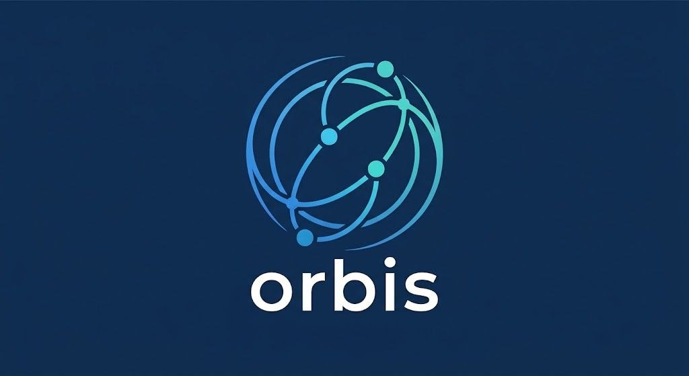

# Orbis



Android map, interactive globe, photo chat and local profile. The interface is in English, with a blue and mint palette.

- **Map / Globe:** MapLibre street map and bundled Cobe globe. The globe responds to phone tilt and touch; motion can be disabled in Profile → Settings.
- **Chats:** Firebase email/password authentication, real-time messages, date separators and photos compressed to 100 KiB.
- **Profile:** local name, bio and cover photo with EXIF orientation correction.

## Build in Android Studio

1. Open this repository. Select **JDK 17**, Android SDK 34, and the **app** run configuration. Minimum Android version: API 26.
2. Register an Android application with package **kz.semey.map** in your Firebase project. Put its downloaded `google-services.json` in `app/` (this local file is intentionally not committed).
3. Enable Firebase Email/Password authentication and Realtime Database. Download the Firebase configuration after creating the database so it includes the database URL. Review `database.rules.json` before publishing rules to your own database.
4. Run:

```sh
./gradlew :app:assembleDebug :app:testDebugUnitTest :app:lintDebug
```

The APK is generated at `app/build/outputs/apk/debug/app-debug.apk`.

The existing package ID is retained so updating an installed Orbis preserves its local data and Firebase session. The launcher name is **Orbis**.

## Development

The current application module uses Java and native Android views. The earlier, separate `livepulse` Kotlin/Compose coursework module is retained but is not the Orbis launcher; its cloud setup was not completed. Run `app` for Orbis.

The globe asset is bundled. To rebuild it:

```sh
cd tools/globe
npm ci
node build.mjs
```

Device photo checks use `kz.semey.map.PhotoCodecInstrumentation`; see [verification](docs/orbis-evidence/checks.md) and [revision design](docs/orbis-revision.md). Historical sensor-lab specifications are superseded: Orbis no longer has a Sensors tab or a light-controlled theme.

Profile edits are stored on the device, scoped to the signed-in account or guest. They do not change the chat identity. Re-select an original photo if an older app version already saved its cover sideways.

## Credits

[MapLibre](https://maplibre.org/), [OpenFreeMap](https://openfreemap.org/), [OpenStreetMap](https://www.openstreetmap.org/copyright), [Cobe](https://github.com/shuding/cobe), [Lucide](https://lucide.dev/). Third-party license notices are in `licenses/`. The Orbis logo was supplied by the project owner.
